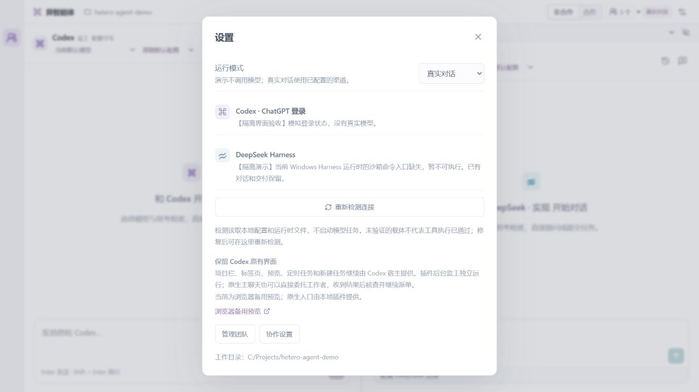

# Windows Harness 运行时自检 · 2026-10-11

版本：0.6.1。目标是避免已确认不能执行命令的载体仍被显示为就绪，减少在模型调用后才发现相同环境故障的重复尝试。

## 根因和范围

本机 SDK/runtime 均为 0.1.5rc1，文件与安装 RECORD 相符。只读检查发现 EXE 有 Windows ACL runner 调用，却缺其 bootstrap 分发分支，子进程误入普通 CLI，最终报 `error: --profile <name> is required`。主 SDK 已传入 `--profile sdk`；权限 preset 名称不是根因。当前下载的官方源码已有相应分发，但它标记为 0.2.1-alpha.1，不能视为已安装载体；[PyPI 发布页](https://pypi.org/project/deepseek-harness-sdk/0.1.5rc1/)仍列 0.1.5rc1 为最新发布。

本轮交付检测和拦截，未修复或重建 EXE。保留原 SDK、模型、sdk profile、权限 patch 和凭证，没有通过放宽沙箱恢复运行。

- 只读 helper 用 SHA256 与字节数共同识别坏载体；已知坏返回 blocked，读取失败返回 failed。不同内容的同版本文件不因版本号被拦。
- 未知 Windows/Node 载体保留 unverified，其他平台 not-applicable；均不冒称工具功能已经验证。
- probe 把文件存在与执行阻碍分开，run 在 SDK 构造和 home 创建之前重新检查。
- 正常预检命中时，DeepSeek 聊天和返工在改输出、派单、扣计数之前拒绝。Codex 核查保留交付仍可单独进行。
- 设置增加「重新检测连接」；重新读取能力使用刷新检查，不改任务或调用模型。当前已运行的任务不会因一次只读探针被自动取消。

## 验证

- 完整回归 239 项通过、0 失败、0 跳过；诊断措辞调整后 13 项专项重新通过。
- 最终构建、原生打包成功；最终资源的 45 项插件专项通过。
- 8 项 Python/桥接检查使用小型合成载体和假 SDK，验证精确匹配、未知状态、原路径替换、读取错误，以及 run 拒绝时不构造 SDK、不创建 home。
- 5 项 Node/调度检查验证负面能力、显式刷新、诊断隐私、聊天保留、返工旧输出保留，以及关闭期间不恢复派单。
- 本机只读探针实际返回 sdk=true、runtime=true、runtimeCheck=blocked、executionReady=false，issue 为 windows-acl-entry-missing。没有执行 EXE、SDK 模型请求或用户任务。
- 隔离界面模拟坏载体时禁用 DeepSeek 输入；重新检测模拟替换载体后恢复输入，同时明确保留未验证说明。状态、消息与用量完全不变，提供方调用 0。
- 420×760 页面宽度 420、弹窗可视和内容宽度 391，无水平溢出。

## 边界与收尾

自检和实际调用之间仍存在文件替换竞态。run 重检命中坏载体时不进入 SDK，但调度可能已经登记尝试；本轮不提供运行时文件锁，也不宣称消除了所有尝试计数变化。

- 插件及 UI 缓存标记已安装为 0.6.1，原认证和权限配置保持不变。新的 MCP 控制连接为 connected，资源为 `ui://relay/v0.6.1/workspace` 和 `ui://relay/v0.6.1/panel`。
- 实际后台安全重载为 0.6.1，原有 4 项任务、消息、团队、会话、草稿及已确认委托书逐项比较一致，用量未增加，仍为 paused，读执行、写执行及清理屏障均为 0。
- 实际能力返回 Codex available=true；DeepSeek available=false、runtimeCheck=blocked、issue=windows-acl-entry-missing。此次读取不执行模型任务；没有恢复已有任务。

本地状态、密钥、运行日志、SDK EXE 和其他任务产物不上传。提交与上传结果以仓库 Git 记录为准。

原生客户端刷新仍待手动完成：本机宿主是 ChatGPT 桌面应用，Computer Use 的操作规则禁止自动操作该应用自身 UI。已有安装和后台可独立核验，当前客户端工具/面板缓存不能据此宣称已刷新。
