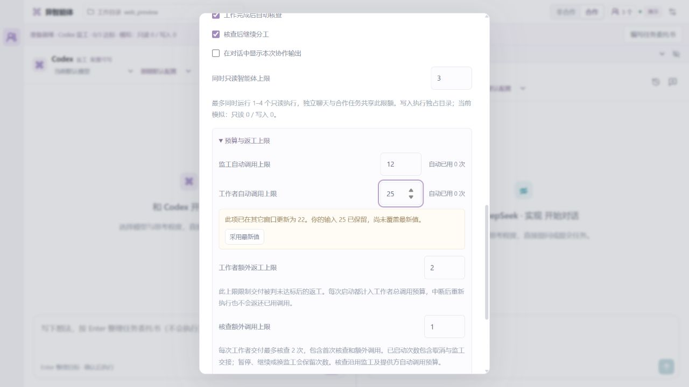

# 多窗口预算保存 · 2026-10-11

版本：0.6.4。解决同一协作在两个窗口打开时，旧设置覆盖新预算，以及正在编辑的数字被服务更新重置的问题。主页面保持双栏，提示只在相关设置下出现。

## 改进

数字字段记录开始编辑时的值，服务的新值不抹掉未保存输入。同字段变更会显示当前值与自己的输入，并提供「采用最新值」；核对后可重新修改。保存请求失败保留输入并提供重试。输入为空或超出范围时也保留并提示，不静默退回旧数字。数字按 Enter 或移开焦点保存，开关立即保存。

官方界面为数字和开关携带 `expectedSettings`，并继续携带 `expectedStateId`。后台在串行操作中先验证全部字段，再核对对应旧值，最后才修改设置、通知与调度。未知字段、空补丁和无效预期字段返回 400，同字段冲突返回 409，整个补丁不生效。不同顶层设置及不同提供方预算可以合并，流式对话引起的全局状态版本变化不会产生误冲突。降低只读并行数仍受正在执行与停止中的占位限制。

设置失败后，界面额外读取一次状态，帮助原生轮询面板更快显示冲突的新值；读取失败保留原错误与输入。不同协作会话重建字段组件，避免跨会话复用未保存预算。保存期间防重复提交，成功后采用最新服务值。

## 验证

- 完整回归 **353 项通过、0 失败、0 跳过**。新增 13 项集成测试覆盖同字段与开关冲突、不同字段及提供方合并、整批拒绝、38 类无效补丁和预期结构、流式输出、旧调用、跨会话保护，以及活动和停止中的只读占位。拒绝检查完整快照、通知、已有输出、用量和提供方调用。
- 前端类型检查、构建和原生插件打包成功。Windows 默认沙箱的实际路径解析限制通过正常审批后的同一构建与回归解决，没有削弱目录校验。
- 隔离界面模拟一次 503：工作者输入 19 保留，重试后成功。窗口 A 输入 25，B 将预算改为 22，A 显示新值但保留 25；采用最新值后为 22。不同窗口把 Codex 和 DeepSeek 预算分别改为 17、18，两项均保存。
- 420×760 第二对话布局中，页面可视与内容宽度均 420；弹窗均 385，冲突提示均 322，没有横向溢出。检查使用模拟数据，未调用真实推理模型。临时标签与隔离服务已关闭，浏览器尺寸已恢复。

## 实际部署

安装前后台 0.6.3 为 live/paused，四项任务，全部执行与清理空闲，磁盘与内存一致。只停止已确认身份的本项目后台并启动 0.6.4，无需重新迁移快照。

重载后逐项摘要比较：协作标识、目标、草稿、已确认委托、运行与合作模式、监工、团队、任务、消息、会话、归档、设置、用量和目录绑定均保留；仍为 paused，四项任务，持久化一致，无执行。Codex 与 Harness 连接可用，继续采用现有修复运行时，没有增加业务调用或重建载体。

插件安装成功，仅更新其界面缓存版本。新建不调用模型的临时控制连接确认 MCP connected、图标、7 项工具和 0.6.4 的两个界面资源。正在使用的宿主窗口缓存没有自动刷新，重新打开面板后才可能加载新界面。提交与上传结果以 Git 记录为准。

## 边界

预期核对基于字段值，不能识别一个值改变后又改回的编辑历史。为保持旧接入兼容，未携带 `expectedSettings` 的请求仍按旧方式更新。未保存输入只存在当前弹窗，关闭或重载后丢弃，已发请求可能仍会完成。自动调用预算不是精确订阅额度或费用上限，手动聊天单独计量。说明见[预算设置](../SETTINGS.md)。
