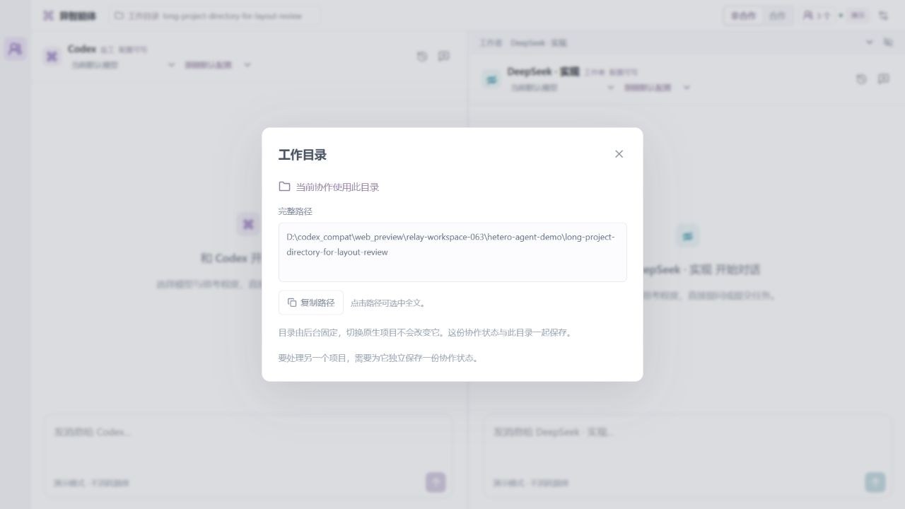

# 工作目录绑定 · 2026-10-11

版本：0.6.3。目标是让用户清楚看到实际执行目录，并阻止改变目录配置后把旧任务和原生会话默默带到其它位置。

## 改进

原后台允许 RELAY_WORKSPACE 更改目录，默认快照仍在固定项目的 .relay/state.json；恢复未核对目录，并在构造器末尾写出状态。本轮增加版本化实际目录绑定，在恢复业务内容前校验。未知旧目录、不同目录或非法绑定抛专用错误；无法读取、损坏 JSON 和无效业务结构也停止，不进入演示状态兜底，不备份为 invalid 后覆盖原文件。

请求目录必须存在并可读，解析为实际路径；提供方、状态、持久化和界面使用同一目录。引擎绑定不可改写，普通、预备确认和失败保存重试都强制使用它。原目录改成指向其它目录的链接时拒绝。Windows 大小写别名不能仅靠字符串折叠相等，需要实际目录身份。

顶部新增紧凑的工作目录入口，完整路径可查看、选择和复制；设置与任务书一致。未绑定旧后台不能从新界面执行，原 context 只作为备用查看。界面与原生委托携带 expectedStateId；后台在动作入口拒绝已过期的会话，无状态变化、无模型调用。旧动作协议未携带标识的调用仍兼容。

旧快照严格迁移工具要求明确原目录、绝对文件路径与原字节 SHA256，验证全部执行和清理结束，再通过文件、父目录身份和再次字节比较进行原子替换。已绑定不能重绑定；保留静止取消任务及暂停的有输出待核查任务，不抹除交付、验收条件或计数。不提供跨进程锁，旧服务必须先停。

## 验证

- 最终完整回归 **340 项通过、0 失败、0 跳过**，构建与原生打包成功。
- 新目录套件覆盖同目录恢复、别名、目录链接改变、A/B 相邻目录拒绝、未知旧目录、非法字段、初始状态与内存篡改、保存失败和预备确认，以及过期会话拒绝。跨目录恢复检查原字节、文件列表、持久化动作和提供方均无变化。
- 迁移检查覆盖哈希、运行与清理状态、已绑定拒绝、正常数据保留、原文件和临时文件被替换、父目录重定向、比较失败、原子替换失败，以及静止取消和等待核查交付保留。
- HTTP 启动拒绝后引擎未创建、原快照未改、端口释放，可由下一服务正常绑定。
- 隔离 UI 在 1280 宽度和 420×760 侧面板验证。窄页面可视／内容宽度均为 420，目录弹窗均为 395，路径文本区均为 357，无横向溢出；复制有明确反馈。隐藏工作者后仍能查看目录，合作任务书保存预览使用同一目录，没有确认执行。

## 实际部署

旧后台 0.6.2 的实际目录已与本项目实际路径核对；当前状态为 live/paused，四项任务，执行和清理均为零，磁盘与内存核心内容一致。只停止明确的该项目后台，保存原快照备份，再按已核实目录和原哈希迁移。

新后台 0.6.3 绑定已生效，仍为 paused，四项任务保留。目标、草稿、已确认委托书、团队、任务、消息、会话、归档、设置和用量逐项哈希一致，持久化一致，无执行或清理。Codex 与 Harness 可用，继续选择 0.6.2 修复运行时；本轮不重建或放宽它的权限，没有调用业务推理模型。

原生客户端自身界面没有自动操作，当前面板缓存的刷新由宿主方式完成。插件安装与提交结果以相应工具及 Git 记录为准。

目录绑定不会自动跟随原生项目，也不等同于服务身份认证、内容身份或外部工具权限隔离。一次后台管理一份协作状态，另一项目应使用独立状态文件。说明见[工作目录与迁移](../WORKSPACE.md)。
